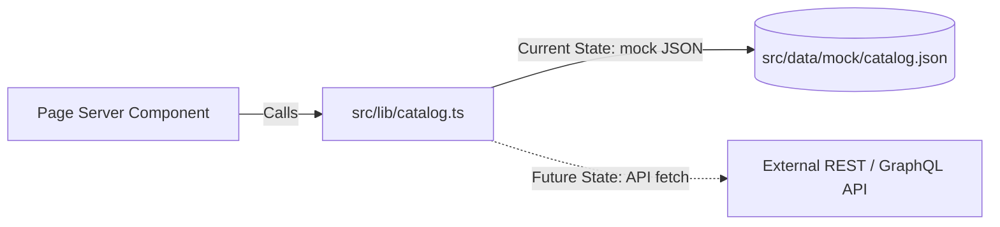
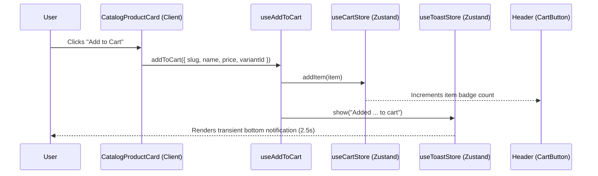

# Crunchzilla UI — Complete Project Understanding & Architectural Blueprint

This document provides a comprehensive, end-to-end understanding of the **Crunchzilla UI** repository. It covers the business domain, architecture, technology stack, directory layout, routing, design system, data seam, state management, recent git activity, known gaps, and recipes for extending the platform.

---

## 1. Executive Summary & Brand Overview

**Crunchzilla** (`Crunchzilla Foods Pvt Ltd`) is a direct-to-consumer (D2C) e-commerce storefront specializing in authentic, slow-roasted traditional Indian staples and regional heritage delicacies.

### Key Brand Facts & Values
- **Regional Specialization**: Gaya (Bihar) heritage Tilkut, Mithila Makhana (Foxnuts), Pure Chana Sattu, Katarni Chura, Basmati Poha, and Organic Jaggery (Gud).
- **Core Value Proposition**: 100% natural, slow-roasted over traditional wood-fired bhattis, zero palm oil, zero chemical preservatives, artisanal small batches.
- **FSSAI License**: `21225192003493`
- **Fulfillment Centers**: Patna / Bihar & Bengaluru, Karnataka.
- **Commerce Model (Current State)**: Direct-to-consumer lead generation and order fulfillment driven primarily through **WhatsApp Direct Ordering** (`+91 7856019631`), supplemented by an in-memory client cart.

---

## 2. Technology Stack & Framework Choices

| Domain | Technology / Library | Version | Role in Project |
| :--- | :--- | :--- | :--- |
| **Framework** | Next.js (App Router) | `16.2.9` | Server-first rendering, React Server Components (RSC), Turbopack bundler |
| **UI Runtime** | React / React DOM | `19.2.4` | Modern concurrent features, Server & Client Component separation |
| **Language** | TypeScript | `^5.x` | Strict type checking across data models, components, and design tokens |
| **Styling** | Tailwind CSS v4 + PostCSS | `^4.x` | CSS-first configuration via `@theme inline` in `src/styles/theme.css` |
| **Class Merging** | `clsx` + `tailwind-merge` | `2.1.1` / `3.6.0` | Custom `cn()` utility extended with custom type-scale tokens |
| **Component Primitives** | shadcn/ui (`radix-ui`) | `^4.11.0` / `^1.6.0` | Accessible unstyled primitives (`Sheet`, `Dialog`, `DropdownMenu`, etc.) |
| **Icons** | Google Material Symbols | Outlined font | `<Icon name="..." filled? />` component via Google Fonts web font |
| **Typography** | `next/font/google` | Built-in | **Playfair Display** (display/headings) & **Plus Jakarta Sans** (body/UI) |
| **Global Client State** | Zustand | `^5.0.14` | Micro-stores for in-memory cart (`cart-store`) and toasts (`toast-store`) |
| **Forms & Validation** | React Hook Form + Zod | `^7.80.0` / `^4.4.3` | Client-side form state and strict schema validation |
| **Installed (Future Seam)** | TanStack React Query & Axios | `^5.101` / `^1.18` | Staged dependencies for future backend REST API integration |

---

## 3. Directory Layout & Codebase Structure

```
crunchzilla-ui/
├── public/
│   ├── favicon.ico
│   └── images/                       # Centralized static media storage
│       ├── brand/                    # Brand assets (logo.png)
│       ├── hero/                     # Hero GIFs and high-res imagery (tilkut-hero.gif, makhana-chai.jpg)
│       ├── products/                 # Packaged product photography (tilkut, makhana, sattu, poha, etc.)
│       └── pantry/                   # Raw ingredients and textures (sesame-seeds.jpg)
│
├── src/
│   ├── app/                          # Next.js 16 App Router routes
│   │   ├── layout.tsx                # Root shell: Google Fonts, icon font, WhatsApp FAB, Toaster
│   │   ├── globals.css               # Imports theme.css, base.css, utilities.css
│   │   ├── page.tsx                  # Route: "/" (Home Page)
│   │   ├── shop/page.tsx             # Route: "/shop" (Product Catalog & Hamper)
│   │   ├── about/page.tsx            # Route: "/about" (Our Heritage & Story)
│   │   └── contact/page.tsx          # Route: "/contact" (Channels, Form, FAQ)
│   │
│   ├── components/
│   │   ├── common/                   # Universal components (Icon, StarRating, SectionHeading,
│   │   │                             # AddToCartButton, Toaster, WhatsAppFab)
│   │   ├── layout/                   # Structural layout (Header, AnnouncementBar, NavLinks,
│   │   │                             # MobileNav, CartButton, Footer)
│   │   ├── home/                     # Home sections (HeroSection, TrustRibbon, PillarsSection,
│   │   │                             # BestsellersSection, ProductCard, MakhanaSpotlight, etc.)
│   │   ├── shop/                     # Shop sections (ShopValueStrip, CatalogHeader,
│   │   │                             # CatalogBrowser, CatalogFilterBar, CatalogProductCard, HamperFeature)
│   │   ├── about/                    # About sections (AboutHero, OriginStory, KitchenPillars,
│   │   │                             # CraftProcess, CommunityLove, EthosCallout)
│   │   ├── contact/                  # Contact sections (ContactHero, WhatsAppDeskCard,
│   │   │                             # ContactChannels, PurityPledge, ContactForm, FaqAccordion, GiftingBanner)
│   │   └── ui/                       # shadcn/ui primitives (button, card, dialog, dropdown-menu, input, sheet)
│   │
│   ├── constants/                    # Single source of truth for text and config
│   │   ├── site.ts                   # Core business facts, phone, FSSAI, nav links, footer links
│   │   ├── images.ts                 # Type-safe registry of all image paths (prevents duplicated assets)
│   │   ├── home.ts                   # Copy for home hero pills, brand pillars, makhana stats
│   │   ├── shop.ts                   # Catalog category tabs, sorting options, badge tone maps
│   │   ├── about.ts                  # Heritage genesis copy, craft processes, community quotes
│   │   └── contact.ts                # Inquiry categories, FAQs, trust badges
│   │
│   ├── data/mock/                    # JSON mock backend data
│   │   ├── products.json             # Bestseller items displayed on the Home page
│   │   ├── catalog.json              # Full 6-item product catalog with variants
│   │   ├── hamper.json               # Festive celebration hamper package
│   │   └── testimonials.json         # Customer verified reviews
│   │
│   ├── hooks/
│   │   └── use-add-to-cart.ts        # Client hook connecting cart store dispatch + toast notifications
│   │
│   ├── lib/
│   │   ├── products.ts               # Server data-access: fetchBestsellers()
│   │   ├── catalog.ts                # Server data-access: fetchCatalog(), fetchFeaturedHamper()
│   │   ├── testimonials.ts           # Server data-access: fetchTestimonials()
│   │   ├── catalog-filters.ts        # Client-safe filtering and sorting algorithms
│   │   ├── whatsapp.ts               # wa.me link builder with URL encoding
│   │   └── utils.ts                  # cn() class merger tailored for custom text tokens
│   │
│   ├── providers/                    # Placeholder for future QueryClientProvider / SessionProvider
│   ├── service/api/                  # Placeholder for Axios HTTP clients / endpoints
│   ├── store/
│   │   ├── cart-store.ts             # Zustand cart store with item quantities
│   │   └── toast-store.ts            # Zustand transient toast notification store
│   │
│   ├── styles/                       # CSS Architecture
│   │   ├── theme.css                 # Design tokens, color palette, MD3 surfaces, type scale
│   │   ├── base.css                  # Base HTML tags, smooth scrolling, selection styles
│   │   └── utilities.css             # Helper classes (container-page, top-header, scroll-mt-header)
│   │
│   └── types/                        # Strict TypeScript interfaces
│       ├── product.ts                # Home page bestseller schema
│       ├── catalog.ts                # Shop catalog schema, variants, badges, sorting keys
│       ├── cart.ts                   # Cart item state interface
│       └── testimonial.ts            # Customer review schema
│
├── components.json                   # shadcn/ui configuration
├── next.config.ts                    # Next.js configuration
├── package.json                      # Project dependencies and npm scripts
└── tsconfig.json                     # TypeScript config with `@/*` path mapping
```

---

## 4. Page Architecture & Section Composition

Each route is built as a **React Server Component** (`page.tsx`) that independently fetches data via the `src/lib/` seam, renders layout wrappers, and mounts dedicated section components.

```mermaid
graph TD
    subgraph Root Layout [src/app/layout.tsx]
        direction TB
        Fonts[Playfair Display + Plus Jakarta Sans]
        Icons[Material Symbols Outlined]
        FAB[WhatsAppFab (Fixed)]
        Toast[Toaster (Fixed)]
    end

    subgraph Pages [App Router Routes]
        P1["/ (Home Page)"]
        P2["/shop (Catalog Page)"]
        P3["/about (Our Story)"]
        P4["/contact (Contact Us)"]
    end

    RootLayout --> Pages

    P1 --> Header1[Header]
    P1 --> H1[HeroSection]
    P1 --> H2[TrustRibbon]
    P1 --> H3[PillarsSection]
    P1 --> H4["BestsellersSection -> ProductCard (Client)"]
    P1 --> H5[PantryBanner]
    P1 --> H6[MakhanaSpotlight]
    P1 --> H7[TestimonialsSection]
    P1 --> H8["FeedbackSection -> FeedbackForm (Client)"]
    P1 --> Footer1[Footer]

    P2 --> Header2[Header]
    P2 --> S1[ShopValueStrip]
    P2 --> S2[CatalogHeader]
    P2 --> S3["CatalogBrowser (Client)"]
    S3 --> S3a[CatalogFilterBar]
    S3 --> S3b[CatalogProductCard]
    P2 --> S4[HamperFeature]
    P2 --> Footer2[Footer]

    P3 --> Header3[Header]
    P3 --> A1[AboutHero]
    P3 --> A2[OriginStory]
    P3 --> A3[KitchenPillars]
    P3 --> A4[CraftProcess]
    P3 --> A5[CommunityLove]
    P3 --> A6[EthosCallout]
    P3 --> Footer3[Footer]

    P4 --> Header4[Header]
    P4 --> C1[ContactHero]
    P4 --> C2[WhatsAppDeskCard]
    P4 --> C3[ContactChannels]
    P4 --> C4[PurityPledge]
    P4 --> C5["ContactForm (Client)"]
    P4 --> C6[GiftingBanner]
    P4 --> C7["FaqAccordion (Client)"]
    P4 --> Footer4[Footer]
```

### Route Breakdown

#### 1. Home Page (`/`)
- **Trust Ribbon**: FSSAI license (`21225192003493`), 4.9/5 rating, free shipping threshold (₹499).
- **Hero Section**: Heritage value badges, call-to-actions (Explore range & WhatsApp order), customer avatar social proof, hero image showcase (`tilkut-hero.gif` and `makhana-chai.jpg`).
- **Pillars Section**: Highlights slow bhatti roasting, unadulterated ingredients, and seasonal freshness.
- **Bestsellers**: Displays 3 top products from `products.json` using client `ProductCard` components featuring size variants, instant cart addition, and WhatsApp quick purchase.
- **Pantry Banner**: Showcases raw heritage items (Katarni Chura, Basmati Poha, Jaggery).
- **Makhana Spotlight**: Nutritional statistics (protein, calcium, calories) and roasting story.
- **Testimonials**: Verified customer feedback cards with star ratings.
- **Feedback Section**: Embedded form validating customer feedback before submission.

#### 2. Shop Page (`/shop`)
- **Value Strip**: Free shipping over ₹499, fresh batch roast pledge, break-free packaging guarantee.
- **Catalog Header**: Dynamic counter showing total available SKUs.
- **Catalog Browser**: Interactive client component with:
  - Category filter pills: *All Products, Tilkut, Makhana, Sattu, Chura & Poha, Organic Jaggery*.
  - Sort dropdown: *Featured, Price: Low to High, Price: High to Low, Most Popular, Highest Rated*.
  - Wishlist toggle buttons per card (local state).
  - Multi-variant selector (weight/size) with automatic price adjustment.
  - WhatsApp quick-order link prefilled with selected SKU and variant.
- **Hamper Feature**: Standalone hero card showcasing the "Festive Heritage Hamper" loaded from `hamper.json`.

#### 3. About Page (`/about`)
- **About Hero**: Brand credibility metrics (500+ happy households, 4.9 rating, Gaya origin).
- **Origin Story**: Narrative explaining the revival of traditional wood-fired roasting in Gaya, Bihar.
- **Kitchen Pillars**: 4 foundational rules: Zero Palm Oil, Wood-Fired Bhatti, Clean Natural Sweeteners, Direct Sourcing.
- **Craft Process**: Step-by-step artisanal methodology (Selection, Slow Roasting, Hand Pounding, Clean Packaging).
- **Community Love & Ethos**: Customer testimonials and pledge against industrial food preservatives.

#### 4. Contact Page (`/contact`)
- **Contact Hero & Badges**: 24/7 support, fast delivery assurance, dedicated dispatch hubs.
- **WhatsApp Desk**: One-click direct link to message the support team.
- **Direct Channels**: Visible phone number, direct email, physical hub locations, Instagram/Facebook links.
- **Contact Form**: Multi-field form with inquiry category radio selectors, name, email, phone, city, and message with full Zod validation.
- **FAQ Accordion**: Expandable answers to shipping, shelf life, payment modes, and bulk ordering.

---

## 5. Design System & Styling Architecture

The project utilizes **Tailwind CSS v4** with CSS-first configuration. Tokens are defined in `src/styles/theme.css` within `@theme inline`.

### 5.1 Color Palette
- **Brand Identity Colors**:
  - `primary` (`#903f00`): Deep roasted earth brown, used for titles and primary branding.
  - `roasted-terracotta` (`#b45309`): Warm amber-terracotta for primary CTAs and active chips.
  - `secondary` (`#3c6843`): Natural botanical green for labels, highlights, and health accents.
  - `botanical-forest` (`#2e5a36`): Forest green for quality assurance badges and sustainability banners.
  - `golden-sand` (`#faf4de`): Soft festive cream for subtle chips and highlights.
  - `cardamom-light` (`#e8f0ea`): Light herbal mint for secondary badges.
  - `warm-amber` (`#d97706`): Used for star ratings and bestseller indicators.
  - `whatsapp-emerald` (`#25d366`): Standard WhatsApp branding for action buttons.
- **Material Design 3 Surfaces**:
  - `surface` (`#fbf9f6`), `surface-container-low` (`#f5f3f0`), `surface-container-high` (`#eae8e5`), `surface-container-highest` (`#e4e2df`).
  - `on-surface` (`#1b1c1a`), `on-surface-variant` (`#564338`).
  - `pure-parchment` (`#ffffff`).

### 5.2 Typography System
Configured through `next/font/google` in `src/app/layout.tsx`:
1. **Headings & Display**: `Playfair Display` (`font-display`, `--font-playfair`) — Editorial serif elegance.
2. **Body & UI**: `Plus Jakarta Sans` (`font-sans`, `--font-jakarta`) — Highly legible modern geometric sans-serif.

#### Custom Type Scale
Rather than using generic `text-sm` or `text-lg`, the codebase specifies complete typography configurations (font size, line height, letter spacing, weight):
- `text-display` (56px) / `text-display-mobile` (36px)
- `text-headline-lg` (40px) / `text-headline-lg-mobile` (28px) / `text-headline-md` (30px) / `text-headline-sm` (22px)
- `text-title-lg` (20px) / `text-title-md` (18px) / `text-title-sm` (16px)
- `text-body-lg` (18px) / `text-body-md` (15px) / `text-body-sm` (13px)
- `text-label-lg` (14px) / `text-label-md` (12px) / `text-label-sm` (11px)

### 5.3 The `cn()` & Tailwind Merge Rule
Because custom type scale classes like `text-label-md` collide with Tailwind’s default color class parsing, `src/lib/utils.ts` extends `tailwind-merge`:

```ts
const twMerge = extendTailwindMerge({
  extend: {
    classGroups: {
      "font-size": [{
        text: [
          "display", "display-mobile", "headline-lg", "headline-lg-mobile",
          "headline-md", "headline-sm", "title-lg", "title-md", "title-sm",
          "body-lg", "body-md", "body-sm", "label-lg", "label-md", "label-sm",
        ],
      }],
    },
  },
});
```
> **Rule**: When adding any new typography utility token to `theme.css`, it must also be added to `src/lib/utils.ts` to prevent `cn()` from deleting it when merged alongside color classes.

### 5.4 Utility Classes (`src/styles/utilities.css`)
- `.container-page`: Standard wrapper max-width (`1280px`) with responsive padding (`px-4 sm:px-6 lg:px-8 mx-auto`).
- `.top-header`: Dynamic sticky offset calculated from `--header-height`.
- `.scroll-mt-header`: Anchor scroll margin avoiding header overlap.
- `.icon-filled`: Sets Material Symbols font variation settings to `FILL: 1`.
- `.no-scrollbar`: Cross-browser utility to hide scrollbars on horizontal scroll containers.

---

## 6. Data Architecture & Backend Seam

The project maintains an intentional separation between UI components and data sources. Even though all data currently originates from static JSON files, pages only communicate with asynchronous accessor functions.



### The Dual Product Datasets
Currently, products exist in two separate mock files tailored for their respective presentation cards:
1. `src/data/mock/products.json`: Used by the Home Page bestsellers section.
2. `src/data/mock/catalog.json`: Used by the Shop page. Contains richer metadata including multiple weight variants, strikethrough MRPs, popularity indexes, category tags, and primary/secondary badges.

### Client-Safe Logic Isolation
To keep production client bundles lightweight:
- Server-side files (`src/lib/products.ts`, `src/lib/catalog.ts`) import the mock JSON files.
- Pure utility algorithms needed by Client Components (such as `filterAndSortCatalog`) are strictly isolated in `src/lib/catalog-filters.ts` and never import JSON directly.

---

## 7. State Management & Interaction Patterns



### State Store Implementations
1. **Cart Store (`src/store/cart-store.ts`)**:
   - In-memory store managing `CartItem[]`.
   - Items are unique by the combination of `slug` and `variantId`.
   - Exports selector `selectCartCount` for reactive rendering in the header badge.
2. **Toast Store (`src/store/toast-store.ts`)**:
   - Manages active toast string message.
   - Handled globally by the `<Toaster />` component in `src/app/layout.tsx` with automated 2500ms auto-dismissal.
3. **`useAddToCart` Hook (`src/hooks/use-add-to-cart.ts`)**:
   - Composable hook that dispatches to both the cart and toast stores simultaneously.
4. **`<AddToCartButton />` Island**:
   - Client wrapper enabling Server Components (such as the Hamper feature) to trigger cart additions without converting the parent section into a Client Component.

### WhatsApp Commerce Link Generation
The core transaction engine uses `whatsappLink(message?: string)` from `src/lib/whatsapp.ts`.
- Encodes target phone number from `SITE.whatsappNumber` (`917856019631`).
- Formats dynamic order requests (e.g., `"Hi Crunchzilla, I want to order Gaya Tilkut (Handmade Gud) (500g)"`).

---

## 8. Current Git Branch State & Active Changes

The workspace is on branch **`feature/develop`**. A review of recent commits and git differences highlights active design refinements:

1. **`HeroSection.js`**:
   - Converted from `.tsx` to `.js` during rapid prototyping.
   - Prices in the hero badge have been commented out.
   - Typo noted on line 34: `text-[#fffaf0]md:text-display` (missing space before responsive breakpoint).
2. **`AnnouncementBar.tsx`**:
   - Top promotional banner has been temporarily commented out.
3. **`Header.tsx`**:
   - Logo subtitle (`SITE.tagline`) commented out to achieve a cleaner header profile.
4. **Product Cards (`ProductCard.tsx` & `CatalogProductCard.tsx`)**:
   - Card price rendering has been adjusted to focus on variant selector prices.
5. **Turbopack Workspace Detection**:
   - Running `next build` inside nested directories can detect lockfiles in parent paths (`/Users/ankitadarsh/package-lock.json`). Specifying `turbopack: { root: __dirname }` in `next.config.ts` or executing clean sandboxed builds resolves this directory traversal warning. Type safety can be verified independently via `npx tsc --noEmit`.

---

## 9. Developer Recipes & Extension Guide

### 9.1 Updating Company Contact Info & Settings
All company details are centralized in `src/constants/site.ts`:
```ts
export const SITE = {
  name: "Crunchzilla",
  whatsappNumber: "917856019631",
  phoneDisplay: "+91 7856019631",
  email: "crunchzilla02@gmail.com",
  freeShippingAbove: 499,
  fssaiLicense: "21225192003493",
  // ...
};
```
Modifying values here automatically propagates across all headers, footers, ribbons, and WhatsApp links.

### 9.2 Adding a New Product to the Shop
1. Place image asset in `public/images/products/<name>.jpg`.
2. Register the path in `src/constants/images.ts`:
   ```ts
   // In products map
   myProduct: "/images/products/my-product.jpg",
   // In catalog map
   myProduct: products.myProduct,
   ```
3. Add the product record in `src/data/mock/catalog.json`.
4. If introducing a new category:
   - Add category key to `CatalogCategory` type in `src/types/catalog.ts`.
   - Add filter entry to `CATALOG_CATEGORIES` in `src/constants/shop.ts`.

### 9.3 Adding a New Route (e.g., `/recipes` or `/faq`)
1. Create `src/app/<route>/page.tsx` as a Server Component.
2. Render `<Header />`, page content wrapped in `<div className="container-page">`, and `<Footer />`.
3. Add link to `NAV_LINKS` in `src/constants/site.ts`.

### 9.4 Connecting a Real Backend API
1. Set API base in `.env.local` (`NEXT_PUBLIC_API_URL=https://api.crunchzilla.in`).
2. Replace mock implementations in `src/lib/products.ts` and `src/lib/catalog.ts` with `fetch()` calls.
3. Replace `console.log(values)` inside `onSubmit` in `ContactForm.tsx` and `FeedbackForm.tsx` with API POST dispatches.
4. If client caching is required, configure TanStack Query in `src/providers/query-provider.tsx` and mount inside `src/app/layout.tsx`.

---

## 10. Architectural Assessment & Future Roadmap

| Priority | Feature / Gap | Recommended Implementation Path |
| :---: | :--- | :--- |
| **P0** | **Cart Drawer / Checkout Page** | Implement a slide-over sheet or dedicated `/cart` route allowing users to view cart items, adjust quantities, review shipping thresholds, and submit the entire cart order over WhatsApp or payment gateway. |
| **P0** | **Unified Product Source** | Merge `products.json` and `catalog.json` into a single canonical product schema so price and variant updates are never out of sync. |
| **P1** | **Cart Persistence** | Wrap Zustand store with `persist` middleware using `localStorage` so items remain between refreshes. |
| **P1** | **HeroSection Restoration** | Standardize `HeroSection.js` back to strict TypeScript (`HeroSection.tsx`) and fix the Tailwind class spacing. |
| **P2** | **Category URL Parameters** | Sync Shop category filters with URL search params (`/shop?category=tilkut`) so footer links and marketing campaigns land directly on filtered views. |
| **P2** | **Dedicated Legal Pages** | Create dedicated routes for `/privacy`, `/terms`, and `/shipping-returns` instead of routing them to `/contact`. |
| **P3** | **Automated Testing Suite** | Add Vitest and React Testing Library for unit testing store logic and components, paired with Playwright for end-to-end checkout flows. |

